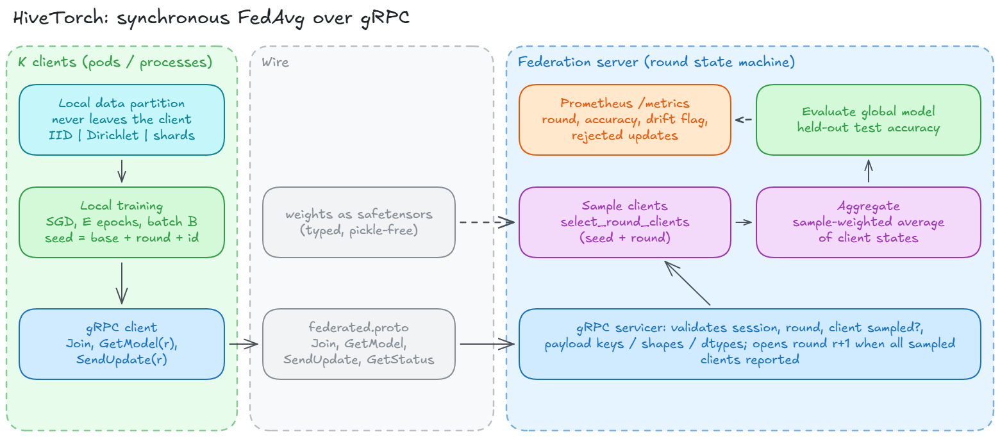
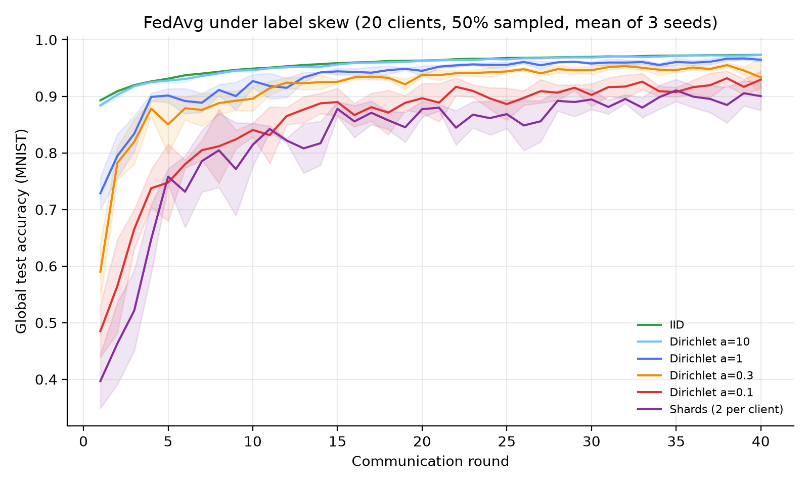

# HiveTorch

**Federated Averaging (FedAvg) in PyTorch with a real gRPC federation: IID / Dirichlet / shard partitions, safetensors transport, Prometheus metrics, Docker Compose and Kubernetes Indexed Jobs.**

   

HiveTorch implements synchronous FedAvg (McMahan et al., 2017) twice, with the same maths:

1. **In-process** (`src/fedavg_core/server/coordinator.py`): the reference implementation, used for experiments.
2. **Over gRPC** (`server/grpc_server.py`, `client/grpc_client.py`): a federation server that runs the round state machine and independent client processes/pods that each hold their own data partition. Weights travel as **safetensors** (typed, pickle-free); the server validates session, round, whether the client was sampled, payload format and tensor shapes/dtypes, and exports Prometheus metrics.

The two are **tested to agree**: a gRPC federation with the same seeds reproduces the in-process accuracy trace to 1e-6 for IID and Dirichlet partitions (`tests/integration/test_grpc_federation.py`).



## Contents
1. [Data heterogeneity results](#1-data-heterogeneity-results) 2. [Running a federation](#2-running-a-federation) 3. [Design](#3-design) 4. [What is tested](#4-what-is-tested) 5. [Repository structure](#5-repository-structure) 6. [Limitations](#6-limitations-and-future-work) 7. [License](#7-license)

## 1. Data heterogeneity results
Test accuracy of the global model on MNIST (MLP 784-128-10, 20 clients, 50% sampled per round, 1 local epoch, SGD lr 0.05, batch 32, 40 rounds, mean of 3 seeds; reproduce with `make experiments`). Partitions: IID; **Dirichlet(alpha)** label skew (Hsu et al., 2019: smaller alpha = fewer classes per client); and pathological shards (each client holds 2 label-sorted shards).

<!-- HETEROGENEITY_START -->
| Partition | Final accuracy (mean ± std) | Best-round accuracy | Rounds to 90% |
|---|---:|---:|---:|
| IID | 97.33% ± 0.07 | 97.33% | 2 |
| Dirichlet a=10 | 97.28% ± 0.01 | 97.28% | 2 |
| Dirichlet a=1 | 96.45% ± 0.40 | 96.68% | 5 |
| Dirichlet a=0.3 | 93.35% ± 3.22 | 95.50% | 11 |
| Dirichlet a=0.1 | 92.94% ± 1.51 | 93.19% | 22 |
| Shards (2 per client) | 90.02% ± 2.50 | 91.04% | 35 |
<!-- HETEROGENEITY_END -->



## 2. Running a federation
```bash
make setup && make test
make simulate                  # in-process FedAvg on the synthetic dataset
make federation-local          # gRPC server + 5 client processes on this machine
make compose-up                # the same in Docker Compose (1 server + 5 client containers)
```
**Kubernetes (Minikube):** `make docker-build cluster-up deploy`. The manifest in `deployments/k8s-simulation-job.yaml` creates a `Service`, a server `Job`, and a client `Job` with `completionMode: Indexed` and 5 completions, so each pod learns which partition it owns from `JOB_COMPLETION_INDEX`; no per-client manifest is needed. This was run end to end on Minikube (server and five client pods completed, final accuracy 0.87 on the synthetic dataset). `deployments/prometheus-rules.yaml` alerts on rejected updates, a drift flag and a stalled federation using the metrics the server exports on port 8000 (`federation_round`, `federation_global_accuracy`, `federation_drift_flag`, `federation_updates_accepted_total`, `federation_updates_rejected_total`).

## 3. Design
**Round protocol.** Clients call `Join` (claiming a partition index), then for each round `GetModel(r)`, which blocks until round `r` is open and returns whether the client was sampled plus the weights; a sampled client trains locally and calls `SendUpdate(r, weights, num_samples)`. When every sampled client has reported, the server aggregates in a fixed order (sample-weighted average), evaluates on its held-out set, opens round `r+1`, and wakes the waiting clients. A client that falls behind is redirected to the open round.

**Determinism.** Client sampling uses `seed + round`; client training uses `seed + round + client_index`, identically in both implementations, which is why they agree.

**Partitioners** (`data/non_iid_sharder.py`): `partition_data_iid`, `partition_data_non_iid` (label-sorted shards, McMahan et al.) and `partition_data_dirichlet`. The Dirichlet partitioner draws per-class client proportions, skips clients that already hold more than their fair share, and redraws until every client has at least `min_client_size` samples.

## 4. What is tested
* gRPC federation == in-process FedAvg (IID and Dirichlet partitions); every sampled client trains exactly once per round.
* The server rejects: out-of-range or duplicate client indices, unknown sessions, wrong rounds, duplicate updates, malformed payloads, wrong tensor shapes.
* Dirichlet partitioner: exact disjoint cover of the data, determinism, label-entropy ordering (`alpha=0.05 < 0.5 < 100`), approaches IID for large alpha.
* CI (`.github/workflows`): `ruff`, `mypy`, generated-stub freshness check, `pytest`; and a container job that runs the 1-server + 5-client Docker Compose federation.

## 5. Repository structure
```text
proto/federated.proto              service + messages (Join, GetModel, SendUpdate, GetStatus)
src/fedavg_core/
  server/   coordinator.py (in-process FedAvg), grpc_server.py, secure_aggregator.py (weighted average)
  client/   edge_trainer.py (local SGD), grpc_client.py
  data/     partitioners, synthetic dataset, batching       rpc/  generated stubs (scripts/gen_proto.py)
  models/ monitoring/ evaluation/ utils/ (safetensors serialization, config)
scripts/    run_heterogeneity_experiment.py, run_local_federation.sh, gen_proto.py
deployments/  k8s Indexed Job + Service, Prometheus rules      docker/  Dockerfile, docker-compose.yml
docs/results/ convergence plot and JSON                        tests/   unit + integration
```

## 6. Limitations and future work
* **Synchronous rounds**: a missing sampled client stalls the round (the server has no straggler timeout); asynchronous or deadline-based aggregation is future work.
* **No privacy mechanisms**: updates are aggregated in plaintext on the server; secure aggregation and differential privacy are not implemented. Transport is gRPC without TLS.
* **Simulated data locality**: every client rebuilds the same dataset from a shared seed and keeps its own partition; real devices would load local data.
* The model is a small MLP; the experiments use MNIST and a synthetic Gaussian-clusters set. The Optuna tuner (`optimization/hyperparameter_tuner.py`) is a stub.

## 7. License
Elastic License 2.0 (see `LICENSE`): use and modify freely, but do not provide the software to third parties as a hosted or managed service.
